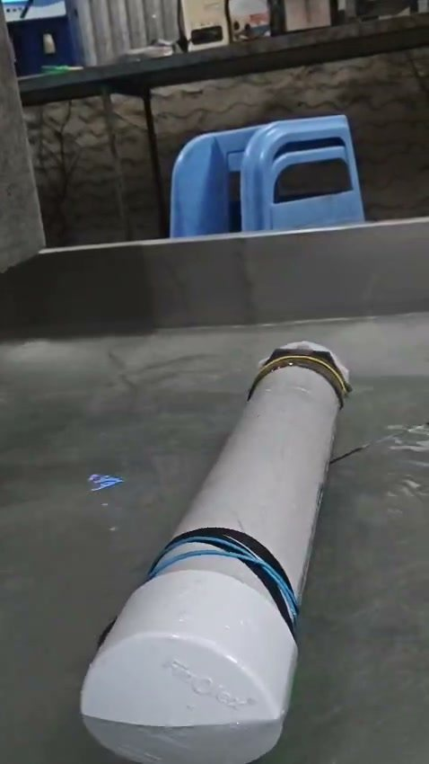

# DIY Submarine — Group 5

**Sanjivani University · Makerspace**

A low-cost underwater vehicle built from a sealed uPVC pipe hull with a threaded, removable access cap, small DC-motor thrusters sealed in PVC sleeves, and a tether that carries power and control from the surface. Designed in SolidWorks, assembled in the Makerspace with laser-cut and 3D-printed (Bambu Lab A1 mini) parts, and float-tested in a water tank.

**Live site:** https://virajpatare2-debug.github.io/DIYsubmarine/



## Status

| Item | Status |
|---|---|
| SolidWorks hull model | ✅ Done |
| Hull, fixed end cap, threaded access cap | ✅ Built |
| Sealed DC-motor thruster pods, strapped to hull | ✅ Built |
| Tether to surface power | ✅ Built |
| Tank test 01 — floats level at the surface | ✅ Done ([video](media/video/Tank_Test.mp4)) |
| CAD updated to twin-thruster layout | ✅ Done ([video](media/video/CAD_Hull_Turntable.mp4)) |
| 5-blade propeller 3D-printed on Bambu Lab A1 mini | ✅ Done ([video](media/video/A1_Mini_Propeller_Print.mp4)) |
| Laser-cut cradles, fins, ballast tray (DXF from SolidWorks) | 🔄 Next |
| Leak test, ballast and trim, submerged run | 🔄 Next |
| Dimensions, mass, motor ratings | 📝 To record |

No performance figures (depth, speed, endurance) have been measured yet.

## Team

1. Autade Yashraj
2. Viraj Patare
3. Pranav Kathale
4. Rushikesh Chinchane

Sanjivani University
**Project guide:** Dr. Kiran Wakchaure

## Repository layout

```
index.html                 Project website (GitHub Pages)
assets/                    CSS, JavaScript, fonts, favicon, link-preview image
media/photos/              Lab photographs and tank-test stills (web size)
media/web/                 ~800 px thumbnails
media/cad-screenshots/     SolidWorks views
media/video/               Tank-test, CAD turntable and 3D-print videos
docs/                      Engineering record (Markdown)
cad/                       SolidWorks native files and exports (add yours)
data/                      Test-log template (CSV)
```

## Documentation

- [Project overview](docs/project-overview.md)
- [Working principle](docs/working-principle.md)
- [Design and materials](docs/design-and-materials.md)
- [Fabrication log](docs/fabrication-log.md)
- [Testing and results](docs/testing-and-results.md)
- [Safety](docs/safety.md)
- [References](docs/references.md)

## Publish on GitHub Pages

1. Create a new public repository on GitHub named `DIYsubmarine` (no README, so the push is clean).
2. In this folder run:
   ```bash
   git init
   git add .
   git commit -m "DIY Submarine: project website and documentation"
   git branch -M main
   git remote add origin https://github.com/virajpatare2-debug/DIYsubmarine.git
   git push -u origin main
   ```
   (Or use GitHub Desktop → *Add local repository* → *Publish*, or drag the files into *Add file → Upload files* on github.com.)
3. On GitHub: **Settings → Pages → Build and deployment → Source: Deploy from a branch → Branch: `main` / `(root)` → Save.**
4. After a minute the site is live at `https://virajpatare2-debug.github.io/DIYsubmarine/`. Paste that link into the repository's *About* box.

The site detects its GitHub address automatically, so the documentation links point to the rendered Markdown pages on GitHub — no edits needed.

## Editing the site

- Dimensions: the *Design specification* table in `index.html` (section 06) and `docs/design-and-materials.md`.
- New photos: add to `media/photos/` and `media/web/`, then add an entry to `assets/js/gallery-data.js`.
- Test results: replace the *No measured results yet* note in section 08 and fill `data/tank-test-log-template.csv`.

## Credits

Fonts: Space Grotesk, Inter, JetBrains Mono (SIL Open Font License, licences in `assets/fonts/`). All photographs and video are the team's own.
