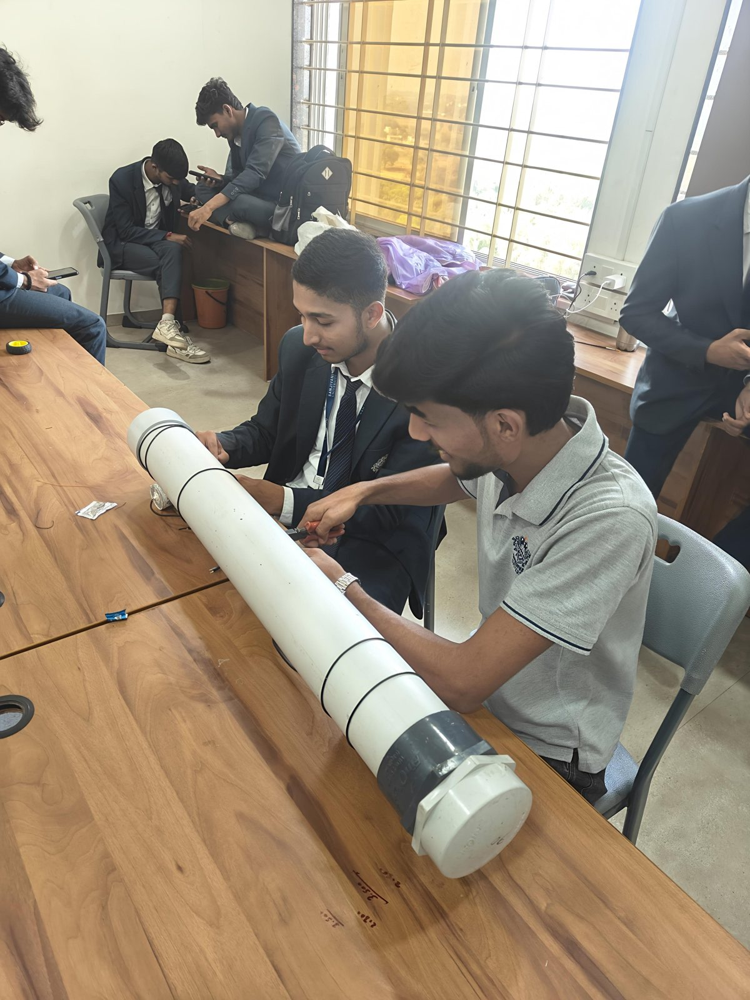
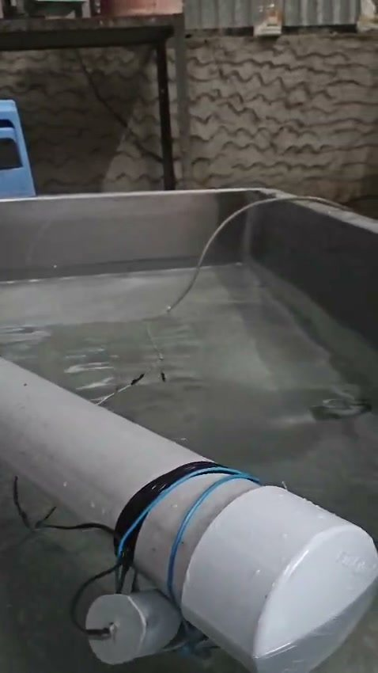

# Fabrication log

Photographs: `media/photos/`. Dates to be added.

## Step 01 — CAD model
The hull was modelled in SolidWorks: pipe body, end caps and a motor mount at the access end.

## Step 02 — Hull, access cap and thruster pods
uPVC hull; grey threaded adapter and white screw-in plug at one end. DC motors housed in short PVC sleeves, open ends packed with white sealant, red four-blade propellers fitted. Two motor pods visible during fitting.

## Step 03 — Strapping, wiring and tether
Wire ties wrapped round the hull at several stations to hold the pods and route the cable. Motor leads joined to the tether.

## Step 04 — Tank test 01
Hull lowered into a water tank; floats level at the surface. See [testing-and-results.md](testing-and-results.md).

