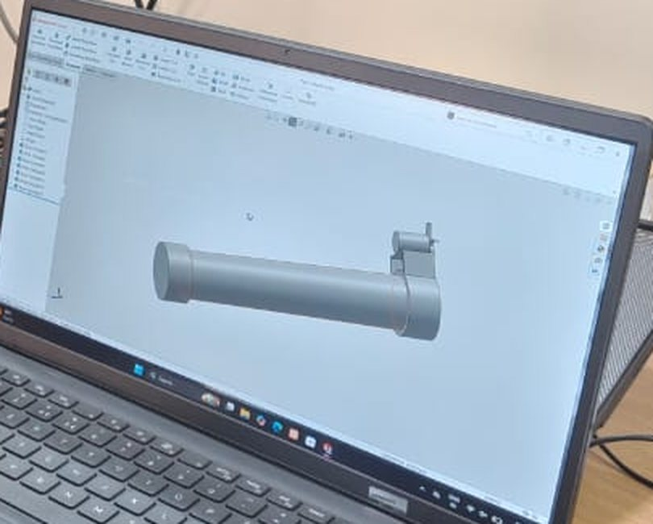
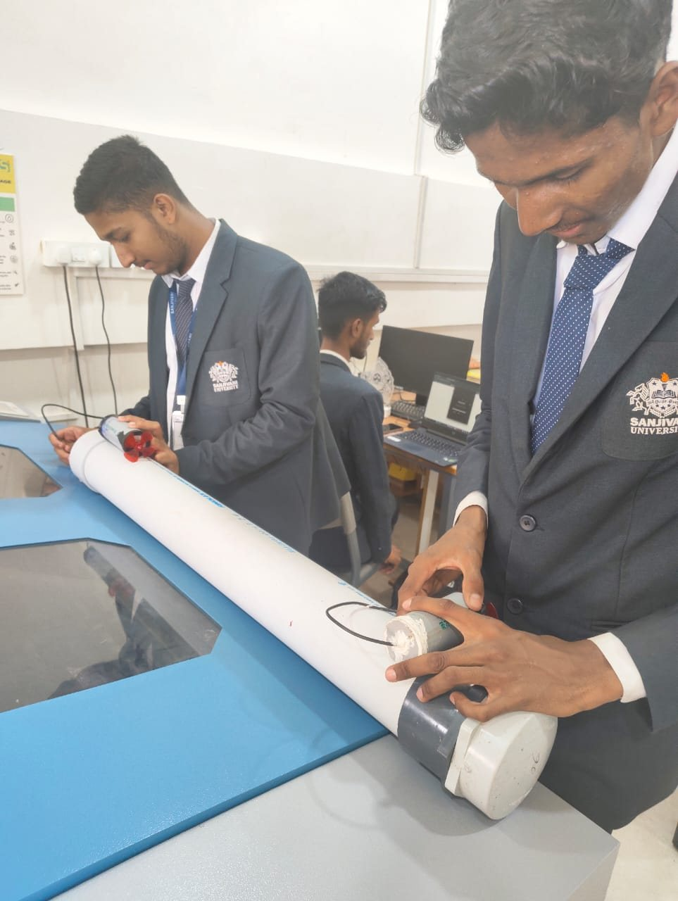
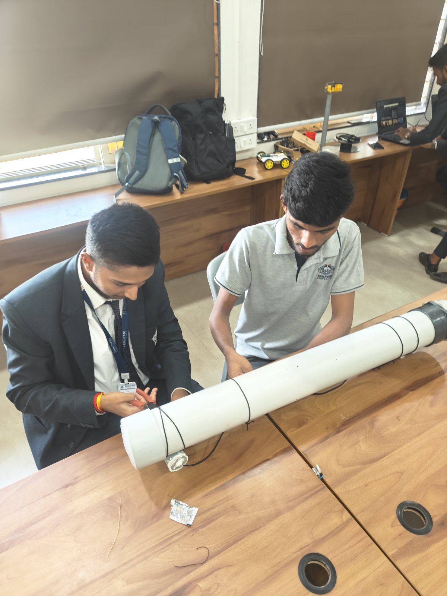
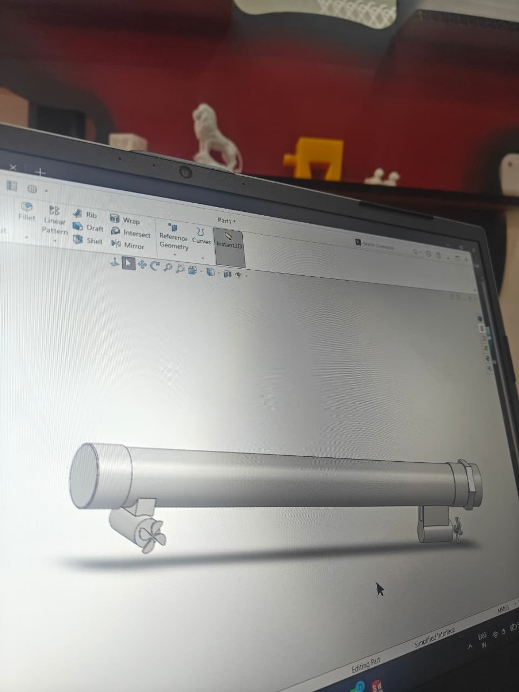
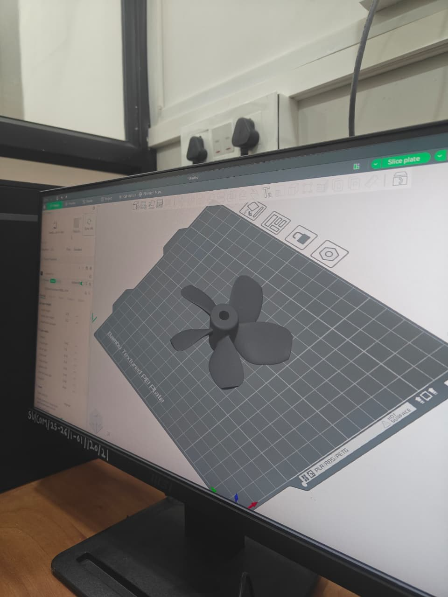
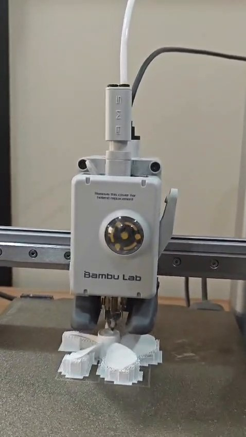
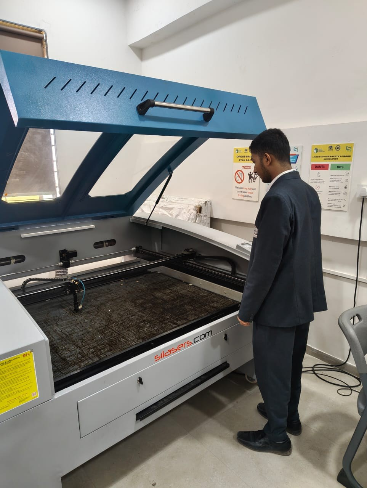

# Fabrication log

Photographs: `media/photos/`. Dates to be added.

## Step 01 — CAD model
The hull was modelled in SolidWorks: pipe body, end caps and a motor mount at the access end.

## Step 02 — Hull, access cap and thruster pods
uPVC hull; grey threaded adapter and white screw-in plug at one end. DC motors housed in short PVC sleeves, open ends packed with white sealant, red four-blade propellers fitted. Two motor pods visible during fitting.

## Step 03 — Strapping, wiring and tether
Wire ties wrapped round the hull at several stations to hold the pods and route the cable. Motor leads joined to the tether.

## Step 04 — Tank test 01
Hull lowered into a water tank; floats level at the surface. See [testing-and-results.md](testing-and-results.md).

## Step 05 — Second iteration: CAD update, 3D-printed propeller, laser-cut parts
The SolidWorks assembly was updated to the as-built layout: two thruster pods with propellers under the hull, threaded access cap at one end.

### 3D printing — Bambu Lab A1 mini
- Part: five-blade propeller, Ø 60 mm, SolidWorks part `Submarine_Propeller_60mm_5mm.SLDPRT` → STL.
- Slicer: Bambu Studio, textured PEI plate; orientation hub-up, blades on the plate with supports under the tips.
- Printer: Bambu Lab A1 mini (180 × 180 × 180 mm, 0.4 mm nozzle). Material: white PLA.
- To record: layer height, wall count, infill, print time, mass. Video: `media/video/A1_Mini_Propeller_Print.mp4`.

### Laser cutting — Makerspace CO2 laser (SIL Lasers)
- Parts: motor-pod cradles, stabiliser fins, internal ballast tray.
- File: DXF exported 1:1 (mm) from the SolidWorks sketch of each flat part.
- Material: 3 mm acrylic or MDF (to confirm). Power, speed and kerf to record after the test cut.

| Setting | Value |
|---|---|
| Laser power / speed | — % / — mm/s (to record) |
| Kerf | — mm (measure on test cut) |
| Print layer height / walls / infill | — mm / — / — % (to record) |
| Print time / mass | — min / — g (to record) |
